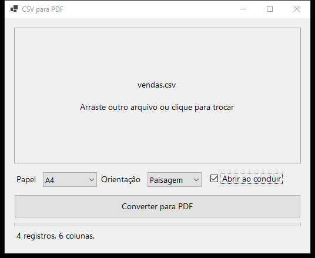

# CsvToPdf

Aplicativo para Windows que transforma arquivos CSV em PDFs com tabelas organizadas, inclusive tabelas muito largas.



## Como usar o aplicativo

1. Abra `CsvToPdfApp.exe`.
2. Arraste um CSV para a janela ou clique para escolher o arquivo.
3. Escolha o papel e a orientação.
4. Clique em **Converter para PDF** e escolha onde salvar.

O `.exe` não precisa de instalação nem do .NET.

## Gerar o executável

Você precisa do [.NET SDK 10](https://dotnet.microsoft.com/download).

```powershell
dotnet publish src/CsvToPdf.Gui -c Release -r win-x64 --self-contained -p:PublishSingleFile=true -p:IncludeNativeLibrariesForSelfExtract=true -p:EnableCompressionInSingleFile=true -p:DebugType=none -o dist
```

O aplicativo será criado em `dist/CsvToPdfApp.exe`.

## O que o conversor faz

- **Somente CSV:** recusa outras extensões e arquivos binários renomeados para `.csv`.
- **Tabelas largas:** reduz a fonte até 6 pt. Se ainda não couber, divide as colunas em blocos e repete a primeira coluna.
- **Textos longos:** quebra o texto dentro da célula e continua registros grandes na página seguinte.
- **Separador automático:** reconhece vírgula, ponto e vírgula, tabulação e barra vertical.
- **Acentos corretos:** lê UTF-8, UTF-16 e Windows-1252, formato comum do Excel em português.
- **Arquivos abertos:** lê um CSV mesmo com ele aberto no Excel.
- **Saída segura:** cancelar ou falhar nunca danifica um PDF que já existia.

## Linha de comando

```text
dotnet run --project src/CsvToPdf -- <entrada.csv> [saida.pdf] [--force]
```

| Argumento | Obrigatório | O que faz |
| --- | --- | --- |
| `entrada.csv` | Sim | Arquivo CSV que será convertido |
| `saida.pdf` | Não | Caminho do PDF. Sem ele, o PDF fica ao lado do CSV |
| `--force` | Não | Substitui o PDF se ele já existir |

## Limites

- Funciona apenas no **Windows**, pois usa a fonte Arial instalada no sistema.
- **Emojis e caracteres chineses, japoneses ou coreanos** aparecem como quadrados.
- A primeira linha do CSV é sempre tratada como **cabeçalho**.
- O arquivo inteiro é carregado na **memória**.

## Estrutura do projeto

```text
src/CsvToPdf.Core/   Leitura do CSV e geração do PDF
src/CsvToPdf.Gui/    Aplicativo com janela
src/CsvToPdf/        Linha de comando
tests/               Testes automatizados
samples/             CSV e PDF de exemplo
```

## Testes

```powershell
dotnet test CsvToPdf.slnx
```

## Dependências

O projeto usa `PDFsharp` fixado na versão **6.2.4**, a última sob licença MIT.

> **Atenção:** a partir da versão 6.5.0, o pacote usa AGPL-3.0 e exige licença em tempo de execução. Avalie a licença antes de atualizar.
